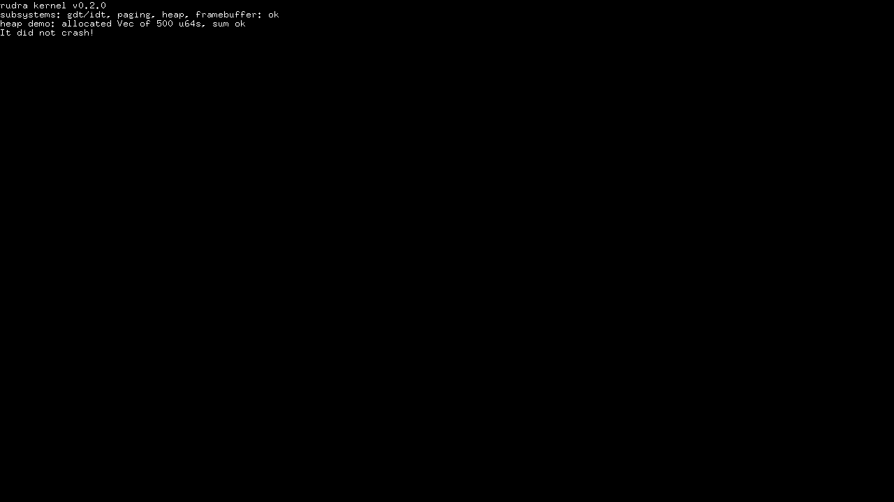
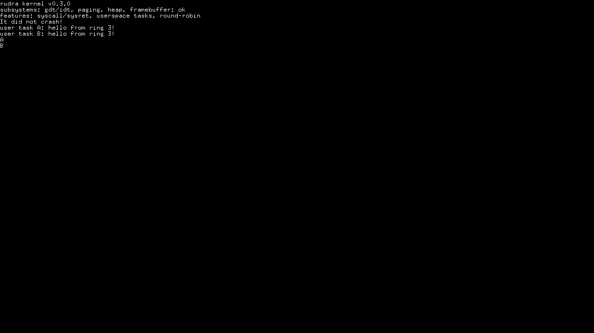

# rudra

**Учебная x86-64 операционная система на Rust** — с нуля, без `std`, с настоящим userspace в ring 3, вытесняющим планировщиком и framebuffer-консолью.


---

## Скриншоты

| Первый запуск (BIOS) | Framebuffer-консоль | Userspace (ring 3) |
|---|---|---|
|  |  |  |

Две задачи в ring 3 работают одновременно — планировщик на таймере PIT вытесняет их
посимвольно (в serial вывод перемешивается: `uusseerr ttaasskk...`), на экране строки
целые, потому что framebuffer-писатель под мьютексом.

## Что уже работает

- **Загрузка** через [bootloader](https://github.com/rust-osdev/bootloader) 0.11
  (BIOS и UEFI/OVMF), собственный builder диск-образов
- **Память**: пейджинг поверх маппинга всей физической памяти, frame allocator
  по карте памяти от bootloader'а, куча 1 МиБ со своим bump-аллокатором
- **Прерывания**: IDT с обработчиками breakpoint / double fault (отдельный IST-стек) /
  **page fault с дампом обхода таблиц L4→L1 и адресом CR2** / general protection fault;
  PIC ремапплен на векторы 32–47; PS/2 клавиатура; PIT
- **Framebuffer-консоль**: свой `DrawTarget` поверх framebuffer от bootloader'а,
  растеризация через [embedded-graphics](https://github.com/embedded-graphics/embedded-graphics)
  + шрифт 8×13, скроллинг, `print!/println!` пишут **одновременно** в serial и на экран
- **Userspace (ring 3)**:
  - GDT с user code/data-сегментами, TSS с переключаемым kernel-стеком
  - интерфейс **syscall/sysret** (LSTAR/STAR/SFMask), syscall'ы: `write`, `exit`
  - загрузка ELF (xmas-elf), у каждой задачи **своё адресное пространство**
    (своя L4: kernel-половина + user-страницы `USER_ACCESSIBLE` в low entry —
    ring 3 не может тронуть страницы ядра)
  - user-программы собираются отдельным no_std-крейтом со статической релокацией
    (без PIE/GOT — релокации не нужны)
- **Планировщик**: вытесняющий round-robin на PIT. Переключение контекста —
  сохранение 15 регистров в asm, смена CR3 + TSS.rsp0 + syscall-стека, `iretq`.
  Корректно работает и при вложенном прерывании внутри syscall
- **Тесты прямо в ядре**: `cargo test` собирает тестовый бинарь ядра и гоняет его
  в QEMU через `isa-debug-exit` — код 33 = pass, 35 = fail

## Архитектура

```
rudra/
├── builder/            # сборка boot-образов (BIOS/UEFI) из ELF ядра
├── user/               # userspace-программы (ring 3, no_std, стат. релокация)
│   └── user.ld         # линковка по 0x400000
├── scripts/
│   ├── build.sh        # user → kernel → образы
│   ├── run-bios.sh     # QEMU, serial → stdout
│   ├── run-uefi.sh     # QEMU + OVMF (q35)
│   └── test.sh         # юнит-тесты ядра в QEMU (isa-debug-exit)
└── src/
    ├── main.rs         # entry_point (bootloader_api), общий поток инициализации
    ├── lib.rs          # init(): gdt → syscall → idt → fb → paging → heap → PIC
    ├── gdt.rs          # kernel/user-сегменты, TSS (IST + privilege stack)
    ├── syscall.rs      # EFER/LSTAR/STAR/SFMask, asm entry, dispatch
    ├── task.rs         # ELF-загрузчик, адресные пространства, round-robin
    ├── memory.rs       # OffsetPageTable, frame allocator (глобальный, один)
    ├── allocator.rs    # bump-аллокатор кучи (1 МиБ)
    ├── framebuffer.rs  # DrawTarget + текстовый писатель (baseline-семантика!)
    ├── interrupts.rs   # IDT, PIC, клавиатура, page fault с дампом таблиц
    └── serial.rs       # COM1 (uart_16550), основной канал отладки
```

### Конвенция syscall'ов

| Регистр | Назначение |
|---|---|
| `rax` | номер (1 = write, 2 = exit), возврат в `rax` |
| `rdi`, `rsi`, `rdx` | аргументы 1–3 |

syscall не переключает CR3: kernel-половина замаплена в каждом адресном пространстве,
а entry переключается на kernel-стек текущей задачи (обновляется планировщиком).

### Как устроено переключение задач

```
PIT IRQ0 → timer_entry (asm): push 15 регистров
         → timer_switch (Rust): EOI, save rsp в текущую задачу,
           Cr3::write, TSS.rsp0 = kstack, syscall-стек = kstack,
           вернуть rsp следующей задачи
         → (asm): pop 15 регистров, iretq
```

Первый запуск задачи — «фальшивый» iret-фрейм на её kernel-стеке
(user CS 0x33 / SS 0x2B, RFLAGS.IF, rip = entry ELF).

## Сборка и запуск

Нужны: Rust **nightly** (`rustup toolchain install nightly`), `rust-src` +
`llvm-tools-preview` (ставятся автоматически через `rust-toolchain.toml`), QEMU ≥ 8.

```bash
# всё собрать (user-программа → ядро → образы BIOS+UEFI)
./rudra/scripts/build.sh

# запуск (serial вывод идёт в консоль; Ctrl+C — выход)
./rudra/scripts/run-bios.sh
./rudra/scripts/run-uefi.sh

# юнит-тесты ядра в QEMU
./rudra/scripts/test.sh
```

Тулчейн хоста — `x86_64-pc-windows-gnu` (без Visual Studio тоже собирается);
QEMU ожидается в `C:\Program Files\qemu`.

## Отладка

- **Serial — главный канал**: всё важное дублируется в COM1, `println!` не умрёт
  при поломке пейджинга
- **Page fault с самодиагностикой**: обработчик печатает CR2, error code и
  обход L4→L1 с флагами present — сразу видно, какой уровень таблиц виноват
- **GDB-стаб**: `qemu -s -S` + `target remote localhost:1234`
- QEMU monitor (`-monitor tcp:...`): `sendkey`, `screendump` — ввод с клавиатуры
  и скриншоты без остановки ВМ

## Проверенные грабли (не наступайте)

1. **`Text` в embedded-graphics позиционирует по baseline**, а не по верху глифа —
   первая строка с `y=0` рисуется целиком за экраном. Baseline = `y + char_h - 2`.
2. **Два инстанса frame allocator'а выдадут одни фреймы дважды** — копия карты памяти
   не знает, что куча/таблицы страниц уже заняли фреймы. Нужен один глобальный.
3. **User-бинарь собирайте со статической релокацией** (`-C relocation-model=static`):
   PIE зовёт функции через GOT, а релокации ELF-загрузчик не делает → `call` в 0x0.
4. **В GDT обязан быть data-сегмент**, и SS/DS/ES надо перезагрузить после своей GDT —
   иначе первое же hardware interrupt ловит GPF на селекторе-фантоме.
5. Сегменты ELF из `lld` **могут делить страницы** — маппить надо уникальные
   страницы, а копировать данные всех сегментов уже потом.
6. xmas-elf читает заголовки через невыравненный `ptr::read` — буфер с `include_bytes!`
   (align 1) надо скопировать в align-8 память.

## Дорожная карта

- [x] Этапы 0–3: freestanding-ядро, serial/VGA, паника, IDT, пейджинг, куча
- [x] Framebuffer-консоль, тесты в QEMU, клавиатура, таймер
- [x] Ring 3: syscall/sysret, ELF, изоляция адресных пространств, round-robin
- [ ] Разные программы в userspace (не одна и та же с разным маркером), `spawn`/`wait`
- [ ] IPC и/или файловые дескрипторы вместо голого write
- [ ] VirtIO-blk + простая FS (или ramdisk с ext2-readonly)
- [ ] Драйвер диска → загрузка программ с диска, а не из образа ядра
- [ ] Раздельные ядровые/пользовательские ELF, сложный (proper) ELF loader
- [ ] async/await внутри ядра
- [ ] SMP: второй CPU, spinlocks
- [ ] Сеть (virtio-net → UDP/TCP)

## Благодарности

Построено стоя на плечах [Writing an OS in Rust](https://os.phil-opp.com/)
(Philipp Oppermann), [OSDev Wiki](https://wiki.osdev.org) и крейтов
организации [rust-osdev](https://github.com/rust-osdev) (`x86_64`, `bootloader`,
`uart_16550`, `pic8259`, `pc-keyboard`, `xmas-elf`). Огромный файл «классических граблей»
выше — результат честной отладки по serial и дампам таблиц страниц.

## Лицензия

MIT / Apache-2.0 на выбор (как у blog_os и всей экосистемы rust-osdev).
