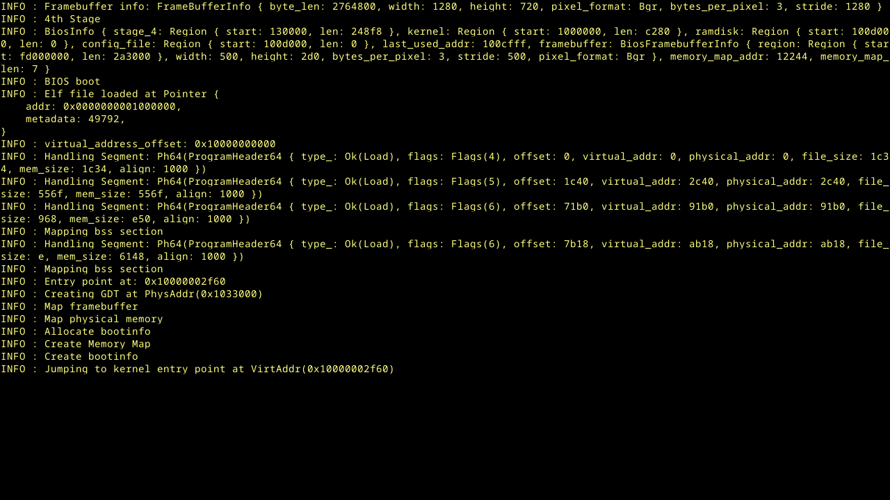
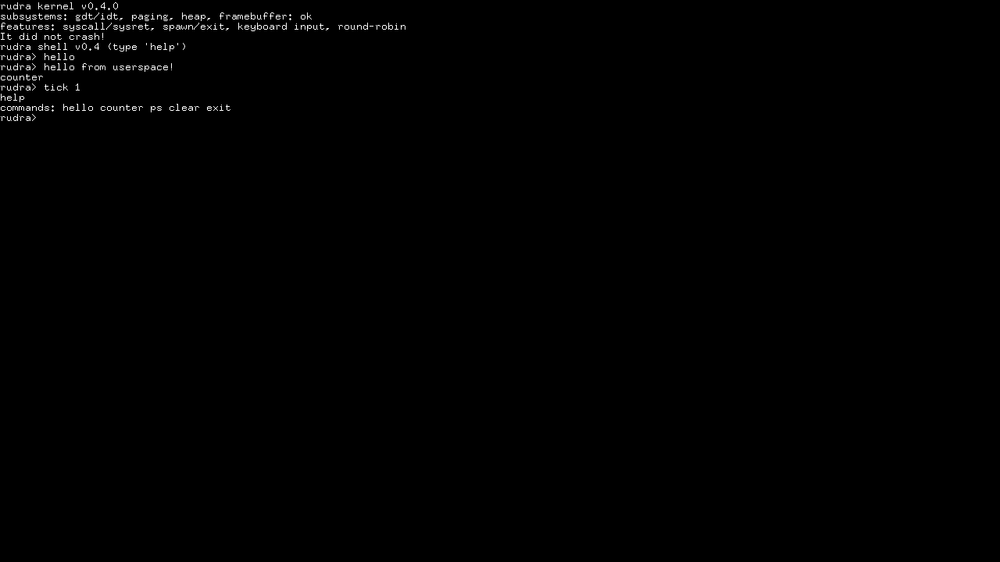
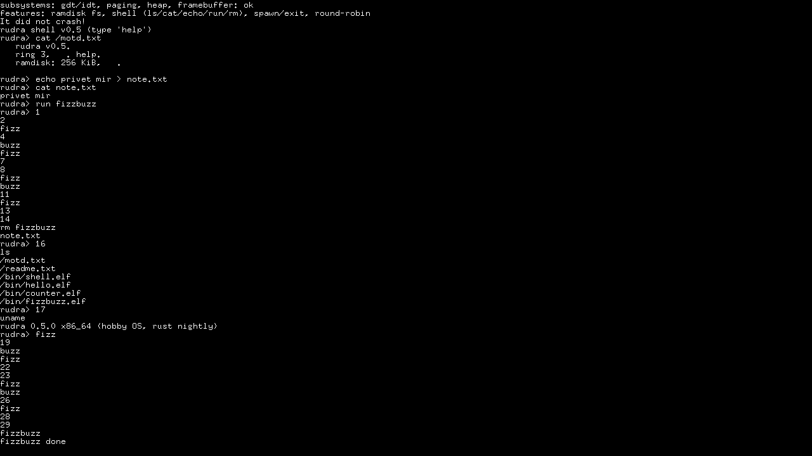
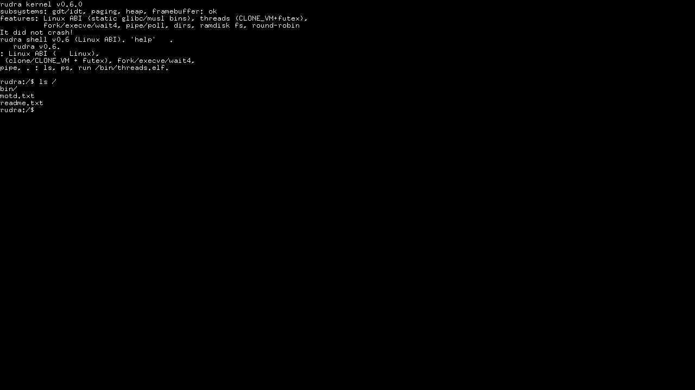

# rudra

**Учебная x86-64 операционная система на Rust** — с нуля, без `std`, с настоящим userspace в ring 3, вытесняющим планировщиком и framebuffer-консолью.

*by Cisco*


**rudra 1.0.1 — research OS. Не ставьте образ на единственный диск с данными.**

Дальше по `main` — серверный контракт 2.0.0, не десктоп. Решения и что уже обещано: [ROADMAP.md](ROADMAP.md), [doc/compat-contract.md](doc/compat-contract.md), [doc/profiles.md](doc/profiles.md). Тег 2.0.0 не стоит. Профиль Desktop пойдёт в ветки `desktop-3.x`.

Релиз — один raw-образ, не ISO: `rudra-1.0.1.img`. Корень — ext2 на том же virtio-blk, с которого идёт загрузка. Файлы живы после reboot. Ramdisk RFS2 остаётся только если диска нет. Контракт, команды и `ENOSYS` — в [RELEASE_NOTES.md](RELEASE_NOTES.md).

```
qemu-system-x86_64 -m 256M -serial stdio -drive if=none,id=vd0,format=raw,file=rudra-1.0.1.img -device virtio-blk-pci,drive=vd0,disable-modern=on,bootindex=0
```

---

## Скриншоты

| Первый запуск (BIOS) | Framebuffer-консоль | Userspace (ring 3) |
|---|---|---|
|  |  |  |

**Интерактивный шелл в ring 3** (v0.4): клавиатура → `read` → `spawn` программ → `exit` с освобождением слота.



**Ramdisk-файловая система + Linux-подобные команды** (v0.5): `ls`, `cat`, `echo > file`, `rm`, `run` —
программы — настоящие файлы `/bin/*.elf`, запускаются по пути.



**Linux ABI и статический busybox** (v0.6): ядро говорит на syscall'ах Linux x86_64.
`ls /` в шелле, `hello` печатает `pid`, `/bin/busybox` (`ls`, `cat`, `echo`, `wc`, `true`, `yes`)
и `threads.elf` (четыре `clone`, общий счётчик без гонки) доходят до `exit 0`.



Две задачи в ring 3 работают одновременно — планировщик на таймере PIT вытесняет их
посимвольно (в serial вывод перемешивается: `uusseerr ttaasskk...`), на экране строки
целые, потому что framebuffer-писатель под мьютексом.

## Что уже работает

- **Загрузка** через [bootloader](https://github.com/rust-osdev/bootloader) 0.11
  (BIOS и UEFI/OVMF), собственный builder диск-образов
- **Память**: пейджинг поверх маппинга всей физической памяти, frame allocator
  по карте памяти от bootloader'а, куча 48 МиБ со своим bump-аллокатором
- **Прерывания**: IDT с обработчиками breakpoint / double fault (отдельный IST-стек) /
  **page fault с дампом обхода таблиц L4→L1 и адресом CR2** / general protection /
  `#UD` / `#NM`; PIC ремапплен на векторы 32–47; PS/2 клавиатура; PIT.
  Пользовательский fault убивает задачу и возвращает шелл, ядровой — паника
- **Framebuffer-консоль**: свой `DrawTarget` поверх framebuffer от bootloader'а,
  растеризация через [embedded-graphics](https://github.com/embedded-graphics/embedded-graphics)
  + шрифт 8×13, скроллинг, `print!/println!` пишут **одновременно** в serial и на экран
- **Userspace (ring 3)**:
  - GDT с user code/data-сегментами, TSS с переключаемым kernel-стеком
  - интерфейс **syscall/sysret** (LSTAR/STAR/SFMask) с **Linux x86_64 ABI**:
    `read/write/openat/close/stat/brk/mmap/clone/execve/wait4/futex/getdents64`
    и соседние номера. `r10` — четвёртый аргумент, entry его не затирает
  - **SSE/FPU**: ядро само включает FXSAVE (`CR0.EM=0`, `CR4.OSFXSR`, без `OSXSAVE`).
    У каждой задачи свой 512-байтный образ, снимок на `clone` и на смене контекста
  - загрузка ELF `ET_EXEC`, у каждой задачи **своё адресное пространство**
    (своя L4: kernel-половина + user-страницы `USER_ACCESSIBLE` в low entry —
    ring 3 не может тронуть страницы ядра); парсер ELF64 — свой, минимальный.
    Статический glibc (busybox) применяет свои `R_X86_64_IRELATIVE` сам
  - user-программы на Rust собираются отдельным no_std-крейтом со статической
    релокацией (`-C relocation-model=static`, скрипт `user/user.ld`)
  - **интерактивный шелл** с эхом и backspace. Встроенные команды ниже;
    внешняя — `execve` файла, `/bin/<cmd>`, `/bin/<cmd>.elf` или
    `/bin/busybox` с argv `busybox <cmd>`. Завершённые задачи освобождают слоты
- **Планировщик**: вытесняющий round-robin. В текущем дереве тик — локальный APIC, около 250 Гц; IRQ0 PIT после калибровки маскируется. Если LAPIC не завёлся, остаётся PIT ~18.2 Гц. Переключение контекста —
  сохранение 15 регистров в asm, `fxsave64`/`fxrstor64` при смене задачи,
  смена CR3 + TSS.rsp0 + syscall-стека, `iretq`.
  Корректно работает и при вложенном прерывании внутри syscall
- **Ramdisk-ФС** (RFS2, 8 МиБ в куче): полные пути до 64 байт, read / write /
  create-or-replace / delete / list. Каталог — отдельная запись (`mkdir` / `rmdir`),
  файл создаётся только внутри существующего родителя. Имя по-прежнему полный путь.
  Образ `rootfs/` собирается `scripts/pack_rfs.py` и вшивается в ядро
  (`include_bytes!`, не ramdisk bootloader'а)
- **PCI и virtio-blk**: обход шины 0. Legacy virtio-blk
  (`1af4:1001`, QEMU `disable-modern=on`) читает и пишет сектора.
  Релизный образ один: первые 16 МиБ — загрузчик, дальше ext2 (блок 4096,
  запись, каталоги). Это корень шелла. Нет диска — `[virtio-blk] no device`
  и `[root] recovery ramdisk`: RFS2 в памяти, не основной корень
- **Тесты прямо в ядре**: `cargo test` собирает тестовый бинарь ядра и гоняет его
  в QEMU через `isa-debug-exit` — код 33 = pass, 35 = fail

### Шелл и команды (ring 3)

```
ls [путь]                 список каталога (mkdir создаёт запись)
cat <файл>                напечатать файл
echo <текст>              напечатать текст
pwd / cd / mkdir / rm
ps / uname / clear / exit
run <программа>           execve пути, /bin/<имя> или /bin/<имя>.elf
<команда> [аргументы]     то же, иначе /bin/busybox <команда>
```

Прогнанный статический busybox: `ls`, `cat`, `echo`, `wc`, `true`, `yes`.
`threads.elf` — четыре потока через `clone(CLONE_VM)` и спин-мьютекс,
счётчик доходит до 400000 без гонки.

## Архитектура

```
rudra/
├── builder/            # сборка boot-образов (BIOS/UEFI) из ELF ядра
├── user/               # userspace-программы (ring 3, no_std, стат. релокация)
│   └── user.ld         # линковка по 0x400000
├── rootfs/             # то, что pack_rfs.py кладёт в RFS2 (bin/busybox, motd)
├── scripts/
│   ├── build.sh        # user → kernel → rudra-1.0.1.img
│   ├── run-bios.sh     # QEMU, один virtio-blk, serial → stdout
│   ├── run-uefi.sh     # QEMU + OVMF (q35), не релизный образ
│   ├── pack_rfs.py     # rootfs/ → recovery-ramdisk RFS2
│   ├── mk_ext2.py      # 16 МиБ ext2 и склейка с загрузчиком
│   ├── smoke.py        # boot → файл → reboot → cat
│   └── test.sh         # юнит-тесты ядра в QEMU (isa-debug-exit)
└── src/
    ├── main.rs         # entry_point (bootloader_api), общий поток инициализации
    ├── lib.rs          # init(): gdt → fpu → syscall → idt → fb → paging → heap → PIC → pci → virtio
    ├── gdt.rs          # kernel/user-сегменты, TSS (IST + privilege stack)
    ├── fpu.rs          # CR0/CR4, FXSAVE-образ задачи
    ├── syscall.rs      # EFER/LSTAR/STAR/SFMask, asm entry, Linux-dispatch
    ├── linux.rs        # номера syscall'ов Linux x86_64
    ├── task.rs         # ELF, fork/clone/execve, адресные пространства, round-robin
    ├── fs.rs           # VFS: ext2, если смонтирован, иначе RFS2
    ├── pci.rs          # обход шины 0 через 0xCF8/0xCFC, BAR, bus master
    ├── virtio_blk.rs   # legacy virtio-blk, одна virtqueue, IN/OUT
    ├── block.rs        # read_blocks / write_blocks, сектор 512
    ├── ext2.rs         # ext2 чтение и запись, корень на диске
    ├── memory.rs       # OffsetPageTable, frame allocator (глобальный, один)
    ├── allocator.rs    # bump-аллокатор кучи (48 МиБ)
    ├── framebuffer.rs  # DrawTarget + текстовый писатель (baseline-семантика!)
    ├── interrupts.rs   # IDT, PIC, клавиатура, page fault с дампом таблиц
    └── serial.rs       # COM1 (uart_16550), основной канал отладки
```

### Конвенция syscall'ов

Linux x86_64. Номер в `rax`, возврат в `rax`, аргументы:

| Регистр | Назначение |
|---|---|
| `rdi`, `rsi`, `rdx` | аргументы 1–3 |
| `r10` | аргумент 4 (не `rcx`: `syscall` кладёт туда user `rip`) |
| `r8`, `r9` | аргументы 5–6 |

Частые номера: 0 read, 1 write, 2 open, 9 mmap, 12 brk, 56 clone, 57 fork,
59 execve, 60 exit, 61 wait4, 78 getdents64, 202 futex.
Полный разбор — `rudra/src/linux.rs`. `SFMask` гасит IF на время entry.

syscall не переключает CR3: kernel-половина замаплена в каждом адресном пространстве,
а entry переключается на kernel-стек текущей задачи (обновляется планировщиком).

### Как устроено переключение задач

```
PIT IRQ0 → timer_entry (asm): push 15 регистров, rsp &= -16
         → timer_switch (Rust): EOI, fxsave уходящей / fxrstor входящей,
           Cr3::write, TSS.rsp0 = kstack, syscall-стек = kstack,
           вернуть rsp следующей задачи
         → (asm): pop 15 регистров, iretq
```

Первый запуск задачи — «фальшивый» iret-фрейм на её kernel-стеке
(user CS 0x33 / SS 0x2B, RFLAGS.IF, rip = entry ELF).

## Сборка и запуск

Нужны: Rust **nightly** (`rustup toolchain install nightly`), `rust-src` +
`llvm-tools-preview` (ставятся автоматически через `rust-toolchain.toml`), QEMU ≥ 8.

```bash
# всё собрать (user-программа → ядро → образы BIOS+UEFI)
./rudra/scripts/build.sh

# запуск (serial вывод идёт в консоль; Ctrl+C — выход)
./rudra/scripts/run-bios.sh
./rudra/scripts/run-uefi.sh

# юнит-тесты ядра в QEMU
./rudra/scripts/test.sh
```

Тулчейн хоста — `x86_64-pc-windows-gnu` (без Visual Studio тоже собирается);
QEMU ожидается в `C:\Program Files\qemu`.

## Отладка

- **Serial — главный канал**: всё важное дублируется в COM1, `println!` не умрёт
  при поломке пейджинга
- **Page fault с самодиагностикой**: обработчик печатает CR2, error code и
  обход L4→L1 с флагами present — сразу видно, какой уровень таблиц виноват
- **GDB-стаб**: `qemu -s -S` + `target remote localhost:1234`
- QEMU monitor (`-monitor tcp:...`): `sendkey`, `screendump` — ввод с клавиатуры
  и скриншоты без остановки ВМ

## Проверенные грабли (не наступайте)

1. **`Text` в embedded-graphics позиционирует по baseline**, а не по верху глифа —
   первая строка с `y=0` рисуется целиком за экраном. Baseline = `y + char_h - 2`.
2. **Два инстанса frame allocator'а выдадут одни фреймы дважды** — копия карты памяти
   не знает, что куча/таблицы страниц уже заняли фреймы. Нужен один глобальный.
3. **User-бинарь собирайте со статической релокацией** (`-C relocation-model=static`):
   PIE зовёт функции через GOT, а релокации ELF-загрузчик не делает → `call` в 0x0.
4. **В GDT обязан быть data-сегмент**, и SS/DS/ES надо перезагрузить после своей GDT —
   иначе первое же hardware interrupt ловит GPF на селекторе-фантоме.
5. Сегменты ELF из `lld` **могут делить страницы** — маппить надо уникальные
   страницы, а копировать данные всех сегментов уже потом.
6. xmas-elf 0.8 в no_std-сборке уходил в `unreachable!()` при обходе program
   headers (на хосте с тем же файлом — не воспроизводилось). Свой парсер
   ELF64-заголовка — 40 строк и ноль магии.
7. **`translate_addr` возвращает физический адрес байта**, не базы кадра.
   Второй раз прибавлять смещение внутри страницы нельзя: запись в хвост
   пользовательского стека уезжает в следующий кадр и затирает чужой GOT.
8. **На входе в `_start` регистры нулевые** (ELF_PLAT_INIT). Статический glibc
   копирует `rdx` в `rtld_fini` и зовёт его на `exit`. Мусор в `rdx` — это
   прыжок в стек уже после того, как программа отработала.
9. **`fxsave64` требует 16-байтного выравнивания.** Пятнадцать `push` с
   выровненного верха стека оставляют `rsp ≡ 8 (mod 16)`, голый `call` входит
   в Rust с `rsp ≡ 0`, и снимок FPU ловит `#GP` с кодом 0. Перед `call` нужен
   `and rsp, -16`.
10. bootloader 0.11 **не включает SSE**. Первая `movd` у glibc — это `#UD`,
    а без гейта `#UD` она превращается в double fault. `OSXSAVE` лучше не
    ставить: glibc тогда выберет AVX-ifunc, которого ядро не ждёт.

## Дорожная карта

- [x] Этапы 0–3: freestanding-ядро, serial/VGA, паника, IDT, пейджинг, куча
- [x] Framebuffer-консоль, тесты в QEMU, клавиатура, таймер
- [x] Ring 3: syscall/sysret, ELF, изоляция адресных пространств, round-robin
- [x] Интерактивный шелл: клавиатура → read, spawn, exit с переиспользованием слотов
- [x] Ramdisk-ФС: ls/cat/echo/rm/run, программы как файлы /bin/*.elf, загрузка ELF из ФС
- [x] Linux x86_64 ABI, fork/clone/execve/wait4, pipe, brk/mmap, статический busybox
- [x] SSE/FXSAVE на задачу, `threads.elf` (clone + общий счётчик)
- [x] Каталоги RFS2 — отдельные записи (`mkdir` / `rmdir` / `rename`), не префиксы
- [x] VirtIO-blk (legacy, одна очередь) и ext2 read-write как корень
- [x] 1.0.0: один raw-образ, reboot сохраняет файлы, smoke и заметки релиза
- [x] 1.0.1: проверка указателей syscall, возврат кадров и кучи, e2fsck, CI
- [ ] SMP: APIC, startup IPI, второй CPU
- [ ] mini-libc и `malloc` через brk для своих программ
- [ ] async/await внутри ядра
- [ ] Сеть (virtio-net → UDP/TCP)

## Благодарности

Построено стоя на плечах [Writing an OS in Rust](https://os.phil-opp.com/)
(Philipp Oppermann), [OSDev Wiki](https://wiki.osdev.org) и крейтов
организации [rust-osdev](https://github.com/rust-osdev) (`x86_64`, `bootloader`,
`uart_16550`, `pic8259`, `pc-keyboard`, `embedded-graphics`). Огромный файл
«классических граблей» выше — результат честной отладки по serial и дампам
таблиц страниц.

## Лицензия

MIT / Apache-2.0 на выбор (как у blog_os и всей экосистемы rust-osdev).
